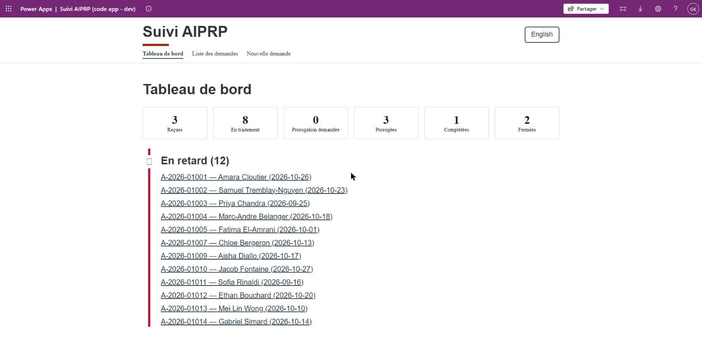
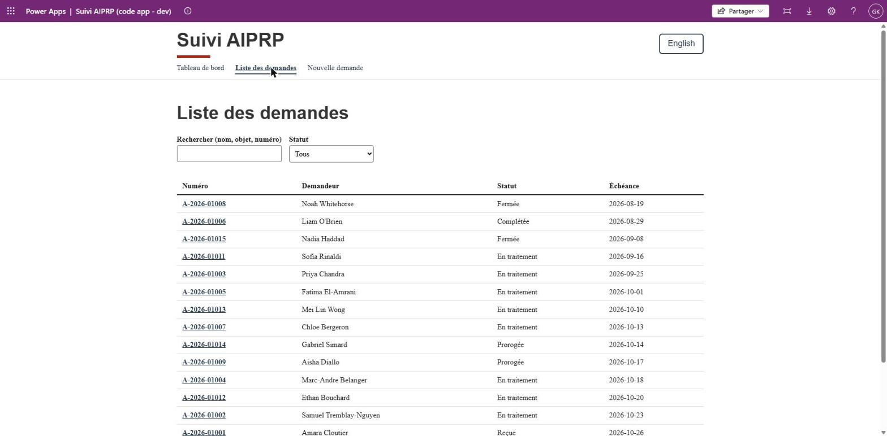
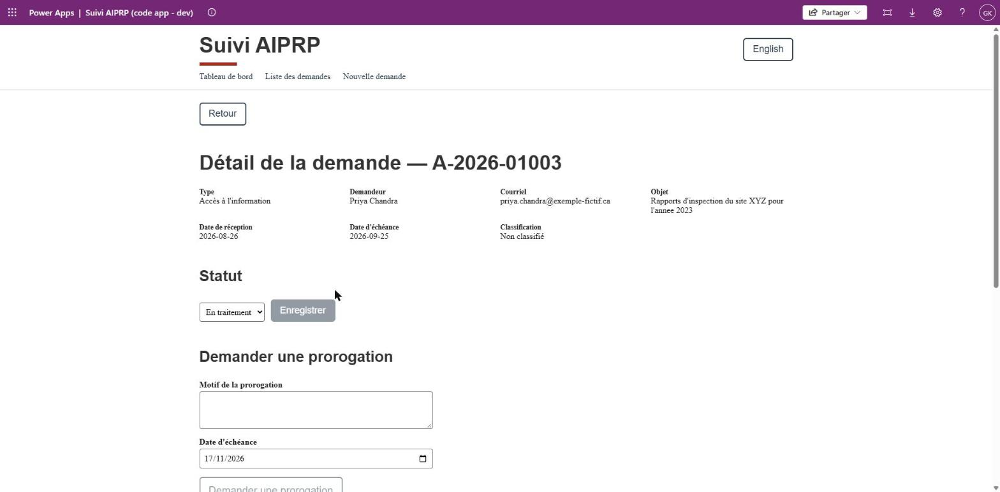
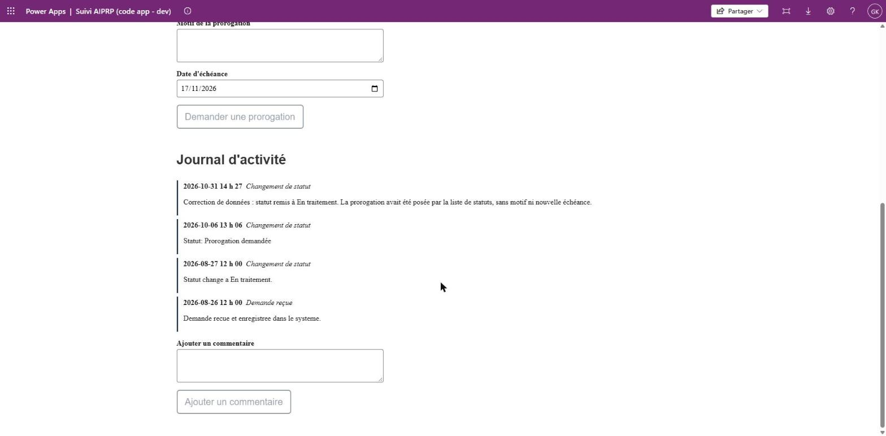
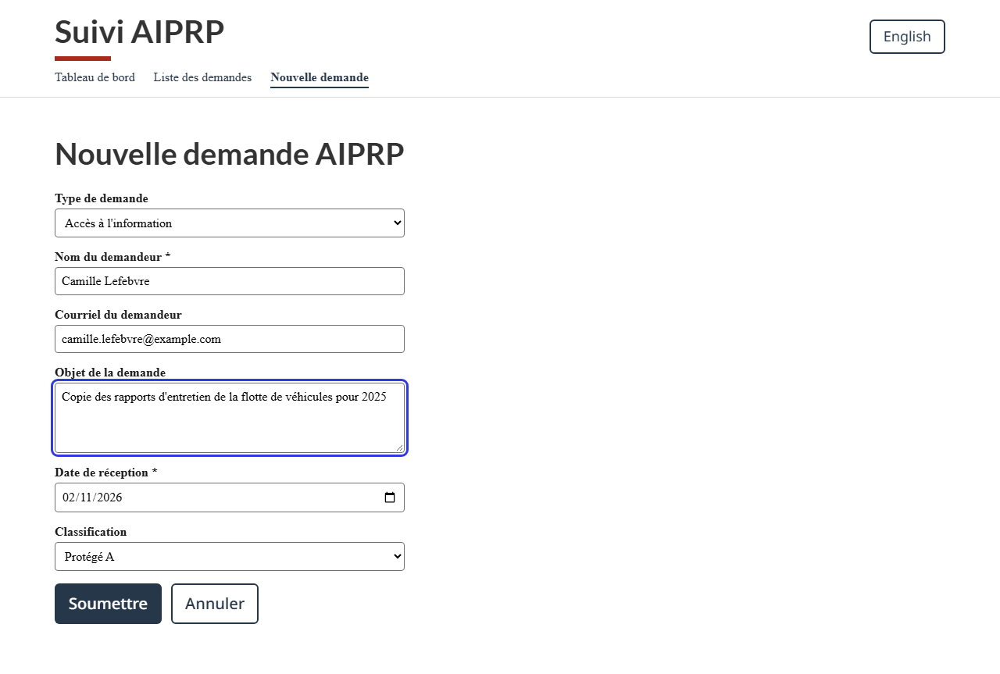
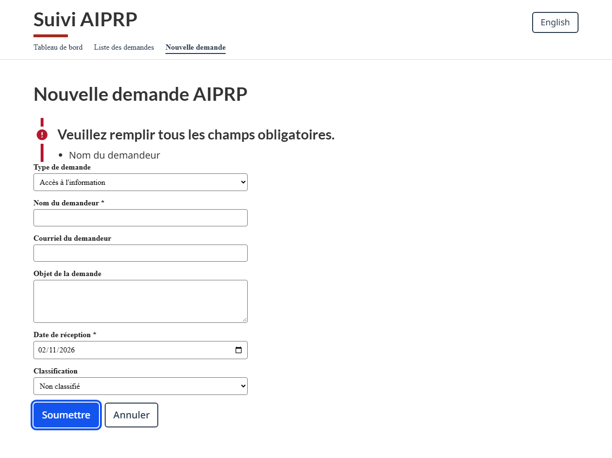
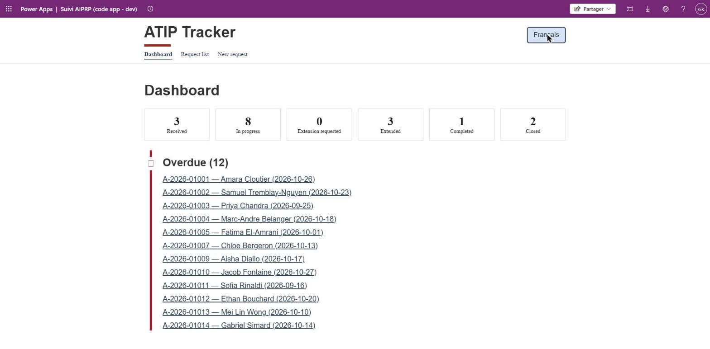
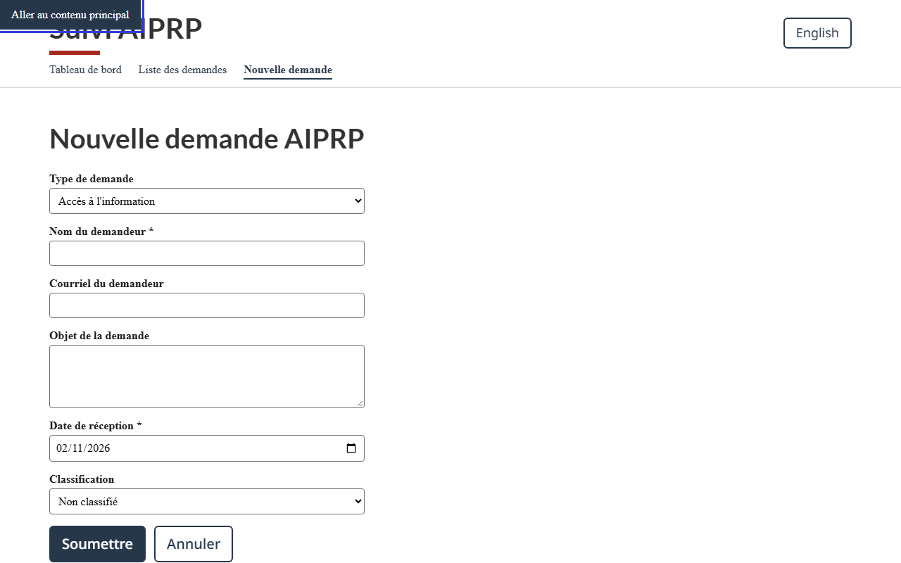

# Guide utilisateur

Ce guide présente les quatre écrans de l'application Suivi AIPRP. Toutes les données affichées
sont fictives.

## Tableau de bord

Le tableau de bord donne l'état du bureau en un coup d'œil :

- une tuile par statut, avec le nombre de demandes ;
- l'encadré **En retard** : les demandes actives dont l'échéance est dépassée ;
- l'encadré **Échéance dans 5 jours ou moins**, quand des demandes arrivent à échéance.

Chaque ligne d'un encadré ouvre le détail de la demande.

## Liste des demandes

La liste affiche toutes les demandes, triées par échéance. La recherche porte sur le nom du
demandeur, l'objet et le numéro ; le filtre limite la liste à un statut. Le numéro ouvre le détail.

## Détail d'une demande

La fiche reprend les informations de la demande, puis permet :

- de changer le **statut**. Les statuts « Prorogation demandée » et « Prorogée » ne sont pas
  proposés : ils sont réservés à la demande de prorogation et à son approbation ;
- de **demander une prorogation**, au statut « En traitement » seulement, avec un motif et une
  nouvelle échéance. Un gestionnaire approuve ou rejette la demande dans le centre d'approbations
  de Power Automate ;
- d'**ajouter un commentaire** au journal.

Le **journal d'activité** garde la trace de chaque action, avec sa date et son heure. Il ne se
modifie pas.

## Nouvelle demande

Les champs marqués d'un astérisque sont obligatoires. La date de réception est préremplie avec la
date du jour. À la soumission, l'application calcule l'échéance légale (30 jours après la
réception), attribue un numéro et inscrit la première entrée au journal.

Si un champ obligatoire manque, un résumé des erreurs s'affiche en haut du formulaire.

## Langue et clavier

Le bouton **English** / **Français** change la langue de toute l'interface. L'application se
parcourt au clavier : la première pression sur **Tab** fait apparaître le lien « Aller au contenu
principal ».

